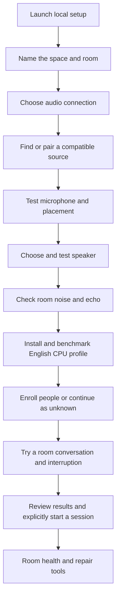

# Milestone 1: Room Conversation Manager

**Status: in progress, 2026-10-12.** M1.1/M1.2 audio setup and the M1.3 English CPU voice-profile foundation are implemented as Windows previews. M1.4 adds the deterministic room manager, session/event contracts, response/playback state, cancellation commands, and continuous/DiPCo replay. Household capture/playback and acoustic/voice exit gates remain pending. Live group sessions, enrollment, and physical interruptions remain planned. See [audio validation](audio-setup.md), [voice-profile validation](local-voice-profile.md), and [room-manager evaluation](room-manager.md).

## Outcome and scope

A regular user can open a guided setup page on their own computer, configure and validate one room's microphone and speaker, install an English CPU voice profile, enroll people, and try an attributed room conversation with interruptions. The system makes uncertainty and failures understandable.

The first supported processing profile is **English, local CPU, one room**. A Core i5-class PC with 16 GB RAM is a target to measure, not a verified minimum specification. Record the exact CPU, OS, audio hardware, and model versions used for validation.

All inference, voice profiles, configuration, and room state remain local in this profile. After dependencies and models are acquired, it must work without internet access. Installation must not activate a microphone, enroll anyone, start a persistent listener, or contact an inference service automatically. Downloads require an explicit installation action and an explanation of their size and purpose; importing already downloaded models should also be possible.

Keep the core in Python. A small browser interface served by the Python application is an agreed part of setup. The preview uses a Python loopback HTTP server and packaged HTML/CSS/JavaScript, with an explicit Windows bootstrap/launcher. A consumer installer remains later work.

**TODO extension profiles:** larger local/GPU models, cloud providers, and additional languages including Farsi. Keep language and execution location independent: a language adapter may use CPU or GPU. English-first validation does not justify English-only data structures.

Milestone 1 delivers the room coordination boundary. A deterministic test responder can exercise playback and interruptions. A capable conversational LLM, durable agent workflows, persistent personal memory, and a broad tool catalog belong to later milestones.

## The first deliverable: M1.1 Room Audio Setup

Begin with installation/launch, a visual localhost wizard, discovery of host audio devices, explicit microphone and speaker tests, and saved room configuration. Room suitability requires both input and output; microphone detection alone is insufficient.

The initial wizard supports microphones and speakers exposed by the host OS. Phone, browser-capture, and network adapters have a place in the design, but are not advertised as working until their extension tracks pass validation.

The user's journey is:

1. Launch setup through an explicit app/launcher action; open the localhost page and provide a clickable fallback address if browser launch fails.
2. Name the first space and room. Explain when the assistant will listen and how to stop it.
3. Choose how audio reaches the application: a device on this computer, this browser, a paired phone/device, or a network source. Initially offer only implemented paths as usable options.
4. Discover compatible devices and select a microphone using a friendly name. Refresh the list after plugging one in; allow manual selection if recommendations are wrong.
5. Start a bounded microphone test. Show an accessible input-level indicator and identify silence, clipping, or an unavailable device. Stop capture on completion or cancellation.
6. Select a speaker, explicitly play a test sound, and confirm that it was heard at a comfortable volume.
7. Check basic placement from the intended speaking position and give concrete recovery advice. The fuller duplex/echo check is completed in M1.2.
8. Save the room's choices and show a summary, a test-again action, and the remaining steps before conversation is available.

The localhost page is a setup/control surface. Native capture and playback belong to the Python audio endpoint. Browser capture is a separate adapter; opening the wizard does not need to open the browser's microphone.

**M1.1 is done when:** on the first target OS, a user can configure a host microphone and speaker without entering device indices, run and stop tests, save/reopen the selection, and recover from permission denial or an unplugged device. No model, account, or background listener is required. If the selected device is missing on return, ask the user to choose again rather than silently switching microphones.

## Source selection and discovery

Separate the **connection method** from the **physical device and intended use**. A USB headset and a USB room microphone share a connection method but need different placement guidance. A phone may be a paired browser endpoint or expose audio through another adapter.

| Connection | Discovery/setup | Important details | Delivery |
| --- | --- | --- | --- |
| Host audio device | Python backend enumerates input/output devices exposed by the OS | Built-in, USB, wired headset, conference unit, or OS-exposed Bluetooth device; record usable channels/rates and a re-identification strategy | M1.1 |
| Browser microphone | Browser permission and device selection | Devices belong to that browser's machine; tab lifetime and browser processing affect capture | Extension A1 |
| Paired phone or computer | Short-lived pairing code or QR flow, then user-approved microphone access | Local network reachability, secure capture context, latency, disconnects, screen lock, and playback location | Extension A1 |
| Existing network audio source | User supplies a supported address/protocol, or selects a compatible advertised endpoint | Codec, timestamps, authentication, jitter, reconnect behavior, and echo-reference availability | Extension A2 |
| File/replay source | User chooses a local fixture | Deterministic development and diagnostics; not a live-room input | M1.3-M1.4 |

The first detector lists OS audio devices without starting a recording. It can recommend a default but must let the user identify the correct device through a test. Do not infer guaranteed room suitability or headset type from a product name.

Later LAN discovery should find compatible endpoints that advertise the project's supported service, not assume every visible phone or network device can provide audio. Start pairing/discovery through a user action and provide an address/code fallback. No automatic broad network scanning is needed.

Device IDs and list positions can change. Store an application endpoint ID plus backend-specific identity information; revalidate on launch and handle ambiguity. A new device must not silently inherit a previous device's trusted pairing or room assignment.

## Visual setup flow

This is the complete planned journey. The wizard implements room naming through saved audio choices, acoustic diagnostics, English CPU model acquisition/benchmarking, and an explicit one-utterance voice test. M1.4 is currently available through device-free CLI replay. Enrollment and live room conversations remain planned. Each phase must provide a useful result without pretending the entire wizard already works.

Use ordinary labels such as "Microphone on this computer", "Use my phone", "Test speaker", and "Someone farther away cannot be heard". Keep sample rates, transport protocols, model IDs, and debug traces in advanced diagnostics.

Show current room, selected source, listening/test status, stop/mute controls, and connection health. Provide text equivalents for meters and sounds, keyboard navigation, and progress messages that do not rely on color alone.

## Ordered delivery phases

| Phase | Work | Exit gate |
| --- | --- | --- |
| **M1.1 Room Audio Setup** | Explicit launcher and localhost wizard; room configuration; native device discovery; bounded input/output tests; saved selections; actionable failures | First household can configure and retest its host audio without editing files |
| **M1.2 Room acoustics and duplex audio** | Reference the actual played audio; establish one owner for echo cancellation; noise/placement checks; audio clock, bounded buffers, gap detection, and device reconnection | Capture remains useful during playback; system does not repeatedly transcribe or interrupt itself; room test results are visible |
| **M1.3 Local English voice profile** | Model import/download management; warm loading; explicit activation; local VAD; streaming STT; local TTS; turn-completion candidate; CPU/RAM and latency measurements | Activate, transcribe an English utterance, and play a test response offline on the recorded target hardware |
| **M1.4 Room manager core** | Common event contracts; session lifecycle; provisional/final utterances; temporary speaker labels; response IDs; playback progress; deterministic reply/replay harness | Replays demonstrate correct turn assembly, late-event handling, session closure, and cancellation without requiring an LLM |
| **M1.5 People and group turns** | Guided voice enrollment; stable person IDs; confidence/unknown states; speaker changes; configurable participation policy; attribution updates | Two enrolled people and an unknown guest can contribute sequentially; uncertain speech is not forced onto a known person |
| **M1.6 Interruptions and milestone validation** | Immediate local output stop; generation cancellation interface; heard-so-far history; overlap recovery; resource contention and restart checks; integrated guided trial | One person can interrupt a reply and another can continue; unresolved overlap produces an understandable recovery path; setup results and performance limits are reported |

**Current gate evidence:** M1.1 has simulated device, configuration, stop, reconnect, permission-error, and browser-flow checks; native read-only discovery works on the Windows development host. M1.2 has actual WebRTC processing exercised with synthetic delayed echo and a separate near signal, exact output-reference checks, clock-gap detection, bounded-buffer/drop checks, and visible diagnostic results. M1.3 has behavior tests and real-model offline file replay/synthesis with CPU/RAM measurements. None of these phases is signed off on the first household's real microphone/speaker. Live duplex transcription and false interruptions remain unvalidated.

M1.1 establishes the audio endpoint interface and basic frame metadata. Later phases extend these contracts rather than replacing the configured input path. Replay fixtures make room logic testable before live recognition is reliable.

M1.4's software replay exit gate passes on the supplied DiPCo subset: all 794
eligible annotation-driven turns assemble correctly with duplicate/late-event
and closure checks. Simulated cancellation and behavior tests cover output state.
M1.3 speech was evaluated separately and remains poor on far microphones; a
development-selected gain preset worsens overall held-out clip WER. See the
[full evidence and limits](dipco-evaluation.md). Dataset replay does not complete
household hardware, identity, or interruption gates.

### First-install packaging and operation

M1.1 needs a repeatable install/launch path for the creator's target OS and recovery when the local port is occupied. The full milestone adds a packaged launcher appropriate for ordinary users, with required runtime dependencies managed explicitly. Developer `uv` commands are not the final consumer installation experience.

Keep setup available after onboarding so users can change devices or repair a room. Document upgrade, configuration migration, model removal, and uninstall behavior, including the user's choice about retaining personal data. Publish only the OS/hardware paths actually tested. Automatic startup is a separate opt-in setting introduced after session lifecycle and recovery are validated.

## Audio-source extension tracks

These tracks reuse the endpoint and room contracts. They can be built after M1.2, but do not block proving the native English CPU profile.

### A1: Browser and paired phone endpoint

Build browser capture on the host first, then a paired endpoint on another device. Inference remains on the host PC, even when audio arrives from a phone.

- Pair by a short-lived code/QR flow; explicitly approve the endpoint and microphone access; support disconnect and revocation.
- The host's localhost address refers to the host only. A phone needs the host's reachable LAN address and a trusted HTTPS capture page. Provide a workable certificate/trust setup or explicitly choose another endpoint approach before calling phone setup easy.
- Use a supported local transport, such as WebRTC, with no mandatory cloud signaling/relay service. Validate the actual local network and explain when it blocks a connection.
- Model playback location explicitly. Phone input with a speaker on the PC is different from a phone providing both input and output. Do not assume browser echo cancellation knows about sound played on another device.
- Handle permission denial, page closure, suspension/screen lock, jitter, and reconnection. Declare any need to keep the page awake; do not promise an always-on phone endpoint before testing it.
- Avoid opening the same physical microphone through both native and browser adapters for one room session.

**Done when:** the user pairs an endpoint, streams local audio, sees its health, interrupts actual playback within measured limits, and can revoke it. Define supported browser/OS combinations from tests.

### A2: Network-source adapters and compatible discovery

Choose one concrete protocol and known source to validate first. Define codec and timing support, protect credentials, bound buffering, expose audio gaps, and provide a reconnect test. Optional discovery lists only compatible advertised endpoints; arbitrary stream URLs remain an advanced path.

**Done when:** a supported source can be connected, assigned to a room, tested, disconnected, and recovered without bypassing room lifecycle or echo checks. Additional protocols remain TODO until separately validated.

## Modular contracts

| Boundary | Contract requirements |
| --- | --- |
| Discovery | List candidates, capabilities, access state, and availability without opening a recording |
| Audio source | Explicit start/stop; timestamped frames; format/channel metadata; source ID; gap and connection events |
| Audio sink | Cancellable playback; response ID; actual playback progress; usable echo reference where supported |
| Speech recognition | Partial replacement and finalization semantics; utterance ID; revision; audio timestamps; language capabilities |
| Speaker attribution | Session-local speaker track separate from stable person ID; evidence timing; unknown state; backend/model version |
| Turn detection | Completion candidates and supported languages; one selected authority for finalizing an utterance |
| Synthesis | Text to cancellable audio chunks; format metadata; response ID; honest playback/text alignment capability |
| Response provider | A deterministic test responder first; later LLM adapters can stream replies without owning room/audio state |
| Model installation | Versioned manifest, license, size, integrity check, local path/import, capabilities, and warm-up/benchmark result |

A provider may implement multiple capabilities, but it must expose them through the same contracts. Do not assume every STT model supplies diarization, every speaker score is a calibrated probability, or every TTS backend supplies word alignment.

Use a small provider registry and explicit configuration. GPU and cloud profiles stay TODO; unavailable adapters are not selectable as functioning providers, and offline mode must never silently fall back to a cloud service.

The first manager owns room state through a deterministic event-processing path. Heavy work happens outside that path. Normalize results to the source audio timeline, correlate revisions by utterance ID, and discard stale output by response ID. Identity inference must not delay output interruption.

Participant state describes people heard in the session, not proof that nobody else is present. Joining does not authorize private memory disclosure. M1 only establishes the context and policy boundary for later memory/tool enforcement.

## Initial evaluation profile and future candidates

M1.3's implemented evaluation profile uses sherpa-onnx 1.12.40 and its matching core package for Silero VAD, English streaming Zipformer (2023-06-26, chunk 16 / left context 128, int8 encoder/joiner), and Piper `en_US-lessac-low`. Profile version 2 replaces the earlier 20M recognizer after replay exposed missing opening words. SoXR handles sample-rate conversion. The versioned catalog pins artifact sizes and SHA-256 checksums, and records code, voice-weight, phonemizer, and training-data license provenance separately. These choices are a working evaluation baseline, not proof of household accuracy. See the [implementation and limitations](local-voice-profile.md). Other candidates below remain unevaluated integrations.

| Part | Candidate for evaluation |
| --- | --- |
| VAD | Silero, local ONNX CPU execution |
| Wake phrase | openWakeWord with an evaluated English model; retain explicit activation as a fallback |
| Streaming STT | Moonshine Tiny/Small Streaming; compare with sherpa-onnx English streaming Zipformer |
| Speaker embeddings | A sherpa-onnx-supported local model or SpeechBrain ECAPA behind the identity adapter |
| Turn completion | Smart Turn's quantized CPU model, evaluated for the actual English speakers |
| TTS | Piper with an evaluated English voice |
| Voice orchestration | Pipecat if its transport/interruption integration meets the contracts |

Select defaults using the complete running pipeline, including accents, names, distance, and concurrent playback. Parameter count and isolated vendor benchmarks are insufficient. Track licenses for code and weights separately; openWakeWord's bundled models currently have noncommercial licensing even though its code is Apache-2.0.

## Validation and completion evidence

Automated behavior tests should use fake devices and synthetic/replay events. Hardware checks require a deliberate local test action, not microphone access during installation or CI. Use opt-in recordings when actual voice fixtures are necessary; do not commit family recordings or profiles.

| Scenario | Required evidence |
| --- | --- |
| First setup | No account required; clear room/source selection; bounded tests; configuration survives relaunch |
| Device failure | Denied permission, silence, busy device, hot unplug, and changed device list produce specific recovery steps |
| Room placement | Test nearby and intended farthest speaking positions; report noise, clipping, and failures rather than a universal "room-ready" guarantee |
| Duplex audio | Run speech during test playback; evaluate echo, false interruptions, and understandable human transcription |
| Local profile | With models installed, run the complete trial without internet; report exact model/hardware versions and resource use |
| Speaker attribution | Two known voices and an unknown voice; report wrong assignments and unknown outcomes separately |
| Group behavior | Speaker handover without a long pause, correction, brief acknowledgment, and deliberate interruption remain attributed |
| Overlap | Preserve uncertainty and ask for repetition when necessary; do not promise accurate simultaneous transcription |
| Lifecycle | Explicit stop/mute, close/reopen, model failure, and restart have predictable behavior; no stale answer resumes |
| Source extensions | Phone/network latency, disconnects, playback placement, and revocation are tested before support is claimed |

Initial targets to measure are approximately **100-250 ms from human speech onset to output stop** and **300-800 ms from the last word to a completed input turn**, including endpointing. These are engineering goals, not current capabilities or hardware guarantees. Report p50/p95, false interruptions, premature turn endings, transcript errors, CPU/RAM use, and audio gaps. Speaker identity has its own evidence window and must not block interruption.

Full answer latency includes the future response provider and TTS; do not report STT inference time alone as end-to-end response time. The first milestone can validate room behavior with a deterministic responder before selecting a local LLM.

**Milestone 1 is complete only when** the initial install-to-trial journey works on recorded target hardware, the English CPU path operates offline, two people can exchange attributed turns and interrupt playback, unknown/overlapping speech has an honest recovery path, and no planned adapter is presented as delivered. Add a user-run guided trial and a documented repeatable validation report to the release evidence.

## References for implementation decisions

- [sounddevice hardware discovery and format checks](https://python-sounddevice.readthedocs.io/en/latest/api/checking-hardware.html).
- [Browser microphone capture requires permission and a secure context; localhost is an exception](https://developer.mozilla.org/en-US/docs/Web/API/MediaDevices/getUserMedia).
- [Browser device enumeration is limited by permissions and the browser context](https://developer.mozilla.org/en-US/docs/Web/API/MediaDevices/enumerateDevices).
- [Moonshine streaming model catalog](https://moonshine-voice.readthedocs.io/en/latest/models/available-models/) and [benchmark definitions](https://moonshine-voice.readthedocs.io/en/latest/using/benchmarks/).
- [sherpa-onnx streaming models](https://k2-fsa.github.io/sherpa/onnx/pretrained_models/online-transducer/index.html) and [speaker identification](https://k2-fsa.github.io/sherpa/onnx/speaker-identification/index.html).
- [Silero VAD](https://github.com/snakers4/silero-vad), [Smart Turn](https://github.com/pipecat-ai/smart-turn), and [openWakeWord language/model licensing](https://github.com/dscripka/openWakeWord).
- [Piper's Python synthesis interface](https://github.com/OHF-Voice/piper1-gpl/blob/main/docs/API_PYTHON.md).
- [Pipecat interruption and heard-so-far context behavior](https://docs.pipecat.ai/pipecat/fundamentals/interruptions).

Recheck versions, capabilities, platform support, and model licenses when implementing. These references identify candidates and constraints, not tested integrations in Family Harness.
